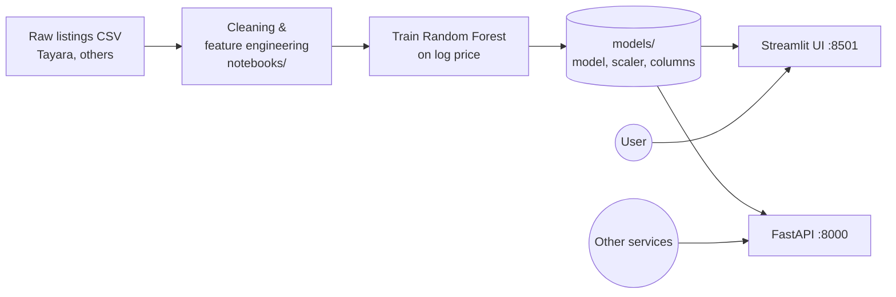

<h1 align="center">🏠 Tunisia Real Estate Price Predictor</h1>
<p align="center">Estimate the market price of an apartment in Tunisia from its size, rooms and city.<br/>
<b>Python · scikit-learn · Streamlit · FastAPI · Docker</b></p>

---

## Problem

Property prices in Tunisia are published across scattered listing sites with inconsistent formats. Buyers and sellers have no quick, data-driven way to know whether an asking price is fair.

## Solution

A Random Forest model trained on cleaned listings scraped from Tunisian real estate sites (Tayara and others). It is served two ways:

- a **Streamlit web app** to try a prediction in a browser, and
- a **FastAPI REST API** (`/predict`, `/predict/batch`, `/cities`) for integration in other apps.

## Architecture



## How it works

1. **Input:** surface area (m²), bedrooms, bathrooms, city.
2. **Preprocessing:** numeric features are standardized with the saved `StandardScaler`; the city is one-hot encoded against the training columns.
3. **Prediction:** the Random Forest predicts `log(1 + price)`; the app converts it back to TND with `expm1`.

## Run it in one command

Requires [Docker](https://docs.docker.com/get-docker/).

```bash
git clone https://github.com/OussemaBouchaala/Appartments_Price_Prediction_Model.git
cd Appartments_Price_Prediction_Model
docker compose up --build
```

- Web app: http://localhost:8501
- API docs (Swagger): http://localhost:8000/docs

Example API call:

```bash
curl -X POST http://localhost:8000/predict \
  -H "Content-Type: application/json" \
  -d '{"superficie": 120, "chambres": 3, "bains": 2, "city": "tunis"}'
```

<details>
<summary>Run without Docker</summary>

```bash
python -m venv venv && source venv/bin/activate   # Windows: venv\Scripts\activate
pip install -r requirements.txt
cd app
streamlit run streamlit.py          # web app
uvicorn app:app --reload            # API
```
</details>

## Project structure

```
├── app/
│   ├── streamlit.py      # Streamlit web app
│   ├── app.py            # FastAPI REST API
│   ├── config.py         # Paths loaded from config.json
│   └── utils.py
├── data/                 # Raw and cleaned listings (CSV)
├── models/               # Trained model, scaler and feature columns
├── notebooks/            # Scraping, cleaning, training experiments
├── config.json           # Central path configuration
├── Dockerfile
└── docker-compose.yml
```

## Model

| | |
|---|---|
| Algorithm | Random Forest Regressor (tuned) |
| Target | `log(1 + price)` in TND |
| Features | surface, bedrooms, bathrooms, city (one-hot) |

## License

MIT
